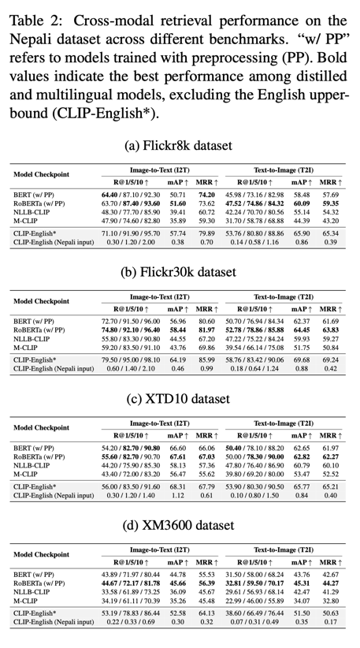
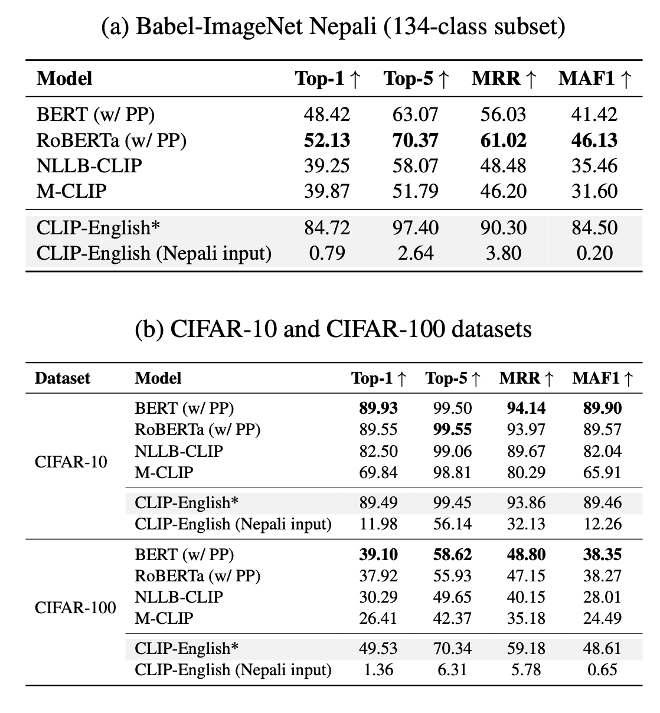
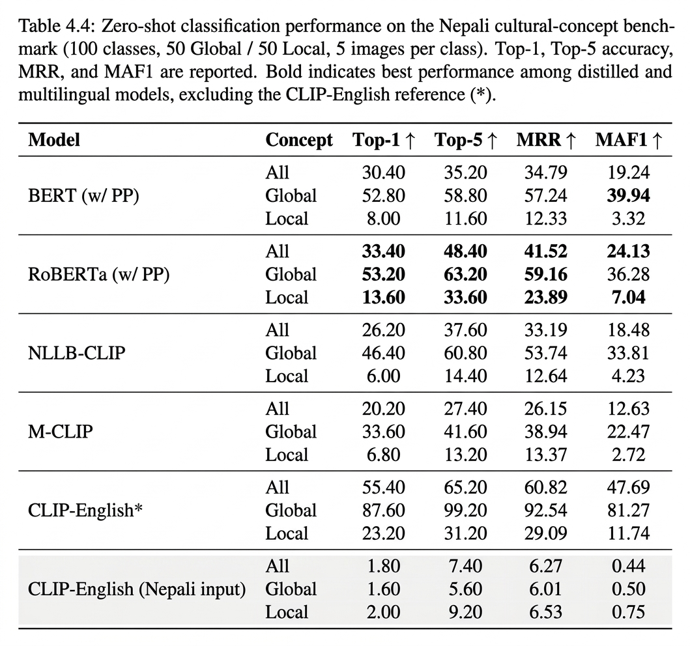

# Nep-CLIP 🇳🇵

Nep-CLIP is a Nepali vision-language model project inspired by CLIP, designed to bridge images and Nepali text through multimodal learning. This repository contains the complete codebase, translated datasets, pretrained models, and training/evaluation pipelines used for Nepali image-text understanding tasks.

## 🔎 Overview

**What it is.** English CLIP cannot read Nepali: given Nepali text, it scores close to zero on every benchmark. Nep-CLIP gives CLIP a Nepali text encoder, so Nepali text and images can be matched directly, without translating to English first.

**How it works.** Cross-lingual knowledge distillation:

* **Teacher:** the frozen CLIP text encoder (`openai/clip-vit-base-patch32`) embeds English captions.
* **Student:** a Nepali text encoder ([NepaliBERT](https://huggingface.co/Shushant/nepaliBERT) or [RoBERTa Nepali 110M](https://huggingface.co/IRIISNEPAL/RoBERTa_Nepali_110M)) plus a linear projection embeds the Nepali translations of the same captions.
* **Training:** the student is trained to produce the same embedding as the teacher (MSE loss) on CC3M and MS-COCO caption pairs.
* **Result:** the student lands in CLIP's embedding space, so it works with CLIP's **unchanged image encoder**. No image training is needed.

**Headline results.** The best Nep-CLIP model against the best multilingual baseline (NLLB-CLIP or M-CLIP) and the English upper bound:

| Task | Benchmark | Metric | Nep-CLIP (best) | Best baseline | CLIP-English* (English input) |
|---|---|---|---|---|---|
| Image → Text retrieval | Flickr30k | R@1 | **74.80** (RoBERTa) | 59.20 (M-CLIP) | 79.50 |
| Text → Image retrieval | Flickr30k | R@1 | **52.78** (RoBERTa) | 47.22 (NLLB-CLIP) | 58.76 |
| Image → Text retrieval | XTD10 | R@1 | **55.60** (RoBERTa) | 44.20 (NLLB-CLIP) | 56.00 |
| Zero-shot classification | Babel-ImageNet Nepali | Top-1 | **52.13** (RoBERTa) | 39.87 (M-CLIP) | 84.72 |
| Zero-shot classification | CIFAR-10 | Top-1 | **89.93** (BERT) | 82.50 (NLLB-CLIP) | 89.49 |
| Zero-shot classification | CIFAR-100 | Top-1 | **39.10** (BERT) | 30.29 (NLLB-CLIP) | 49.53 |
| Zero-shot classification | Local Nepali dataset | Top-1 | **33.40** (RoBERTa) | 26.20 (NLLB-CLIP) | 55.40 |

Nep-CLIP beats both multilingual baselines on every benchmark, nearly matches English CLIP on XTD10, and exceeds it on CIFAR-10. Nepal-specific concepts remain the hardest case for every model. See [Benchmark Results](#-benchmark-results) and [Key Findings](#-key-findings) for details.

**What's included.**

* Two distilled Nep-CLIP models on [Hugging Face](https://huggingface.co/sagarsishir51/Nep-CLIP).
* Nepali translations of Flickr8k, Flickr30k, XTD10 and XM3600, and a new **local Nepali zero-shot benchmark** (100 classes, 50 Nepal-specific and 50 global).
* Evaluation scripts for image-text retrieval and zero-shot classification.
* A **Gradio demo app** for retrieval and zero-shot classification, with **Grad-CAM++ explanations** of which image region each query word matches.

## 📑 Table of Contents

* [Overview](#-overview)
* [Datasets](#-datasets)
* [Pretrained Models](#-pretrained-models)
* [Evaluated Models](#-evaluated-models)
* [Benchmark Results](#-benchmark-results)
  * [Image-Text Retrieval](#image-text-retrieval)
  * [Zero-Shot Image Classification](#zero-shot-image-classification)
  * [Local Zero-Shot Image Classification](#local-zero-shot-image-classification)
  * [Key Findings](#-key-findings)
* [Project Structure](#-project-structure)
* [Setup and Installation](#setup-and-installation)
  * [1. Clone the Repository](#1-clone-the-repository) · [2. Virtual Environment](#2-create-a-virtual-environment) · [3. Dependencies](#3-install-dependencies)
  * [4. Evaluation Datasets](#4-download-evaluation-datasets) · [5. Nep-CLIP Datasets](#5-download-nep-clip-datasets) · [6. Pretrained Models](#6-pretrained-models-hugging-face)
  * [7. Retrieval Evaluation](#7-run-image-retrieval-evaluation) · [8. Zero-Shot Evaluation](#8-run-zero-shot-image-classification) · [9. Local Zero-Shot Evaluation](#9-run-local-zero-shot-image-classification)
  * [Evaluating NLLB-CLIP and M-CLIP (Separate Environment)](#nllb--m-clip-compatibility)
  * [10. Image Embeddings](#10-generate-image-embeddings-for-the-demo-app) · [11. Demo App](#11-run-the-nep-clip-demo-app)
* [Notes](#-notes)
* [Acknowledgements](#-acknowledgements)
* [License](#-license)

---

## 📊 Datasets

All Nep-CLIP data is in one Google Drive folder. Download and placement instructions are in [step 5](#5-download-nep-clip-datasets).

> 🔗 <a href="https://drive.google.com/drive/folders/1kovgPWgzIfNO_Cv64rGTgCTBQDelE8k2?usp=sharing" target="_blank" rel="noopener noreferrer"><b>Download Nep-CLIP Datasets (Google Drive)</b></a>
>
> ⚠️ For **educational use only**. See [License](#-license).

### Training and validation data

Image-text pairs used for knowledge distillation, in Apache Parquet (`.parquet`) format.

| Folder | Contents | Used for |
|---|---|---|
| `Training_Data/` | CC3M (568 files) and MS-COCO (1 file) | Distillation training |
| `Validation_Data/` | CC3M (3 files) and MS-COCO (1 file) | Monitoring training |
| `CC3M_Captions/` | English CC3M captions (`id`, `text`, `url`) | Source text for translation |

### Translated benchmark datasets

Evaluation captions translated into Nepali.

| Dataset | Translation | File |
|---|---|---|
| Flickr8k | Google Translate | `flickr8k_nepali_output_google_translate.csv` |
| Flickr30k | Google Translate | `flickr30k_nepali_output_google_translate.csv` |
| Flickr30k | IndicTrans2 | `flickr30k_nepali_output_indictrans2_translate.csv` |
| XTD10 | Google Translate | `xtd10_google_translate.csv` |
| XM3600 | Google Translate | `xm3600_google_translate.csv` |

### Local Nepali image datasets

| Folder | Contents | Used for |
|---|---|---|
| `nepali_dataset/` | Nepali images | Demo app's Image Retrieval index ([step 10](#10-generate-image-embeddings-for-the-demo-app)) |
| `nepali_dataset_zsc/` | 500 images, 100 classes (50 Local, 50 Global) + `_image_label_mapping.csv` | Local zero-shot benchmark ([step 9](#9-run-local-zero-shot-image-classification)) |

---

## 🧠 Pretrained Models

The distilled Nep-CLIP checkpoints are on Hugging Face. The code downloads them automatically ([step 6](#6-pretrained-models-hugging-face)).

> 🤗 <a href="https://huggingface.co/sagarsishir51/Nep-CLIP" target="_blank" rel="noopener noreferrer"><b>Nep-CLIP Models (Hugging Face)</b></a>
>
> ⚠️ For **educational use only**. See [License](#-license).

| Model | Hugging Face file | Text encoder |
|---|---|---|
| Nep-CLIP (RoBERTa) | `nep-clip-roberta/model.pt` | [RoBERTa Nepali 110M](https://huggingface.co/IRIISNEPAL/RoBERTa_Nepali_110M) |
| Nep-CLIP (BERT) | `nep-clip-nepaliBERT/model.pt` | [NepaliBERT](https://huggingface.co/Shushant/nepaliBERT) |

Both are Nepali text encoders with a linear projection, trained by knowledge distillation to match CLIP's text embeddings. They are used with CLIP's original image encoder (`openai/clip-vit-base-patch32`).

---

## 📋 Evaluated Models

The following models were evaluated on image-text retrieval and zero-shot image classification (including the local Nepali dataset):

| Model | Label in the result figures | Description |
|---|---|---|
| Nep-CLIP (RoBERTa) | `RoBERTa (w/ PP)` | Distilled Nep-CLIP model with the RoBERTa Nepali 110M text encoder |
| Nep-CLIP (BERT) | `BERT (w/ PP)` | Distilled Nep-CLIP model with the NepaliBERT text encoder |
| NLLB-CLIP | `NLLB-CLIP` | Multilingual baseline |
| M-CLIP | `M-CLIP` | Multilingual baseline |
| CLIP-English | `CLIP-English*` | Original English CLIP with English input: the English upper bound |
| CLIP-English (Nepali input) | `CLIP-English (Nepali input)` | Original English CLIP given Nepali text, without any adaptation |

> **Note**
>
> * **w/ PP** means *with preprocessing*: both Nep-CLIP models were trained with preprocessing.
> * **CLIP-English\*** is marked with an asterisk because it uses English text, so it is a reference upper bound rather than a competitor.

---

## 📈 Benchmark Results

This section summarizes the performance of **Nep-CLIP** across multiple downstream evaluation tasks.

> All benchmark evaluations were conducted on **Google Colab (NVIDIA L4 GPU)**.

---

### Image-Text Retrieval
The following figure summarizes the image-text retrieval performance of Nep-CLIP across all evaluation benchmarks (Flickr8k, Flickr30k, XTD10, and XM3600).

<p>
  
</p>

**Figure:** Cross-modal retrieval performance on the Nepali datasets. **w/ PP** denotes models trained with preprocessing (see [Evaluated Models](#-evaluated-models)). **Bold** values indicate the best performance among the distilled and multilingual models, excluding the English upper-bound (CLIP-English*).

### Zero-Shot Image Classification
The following figure summarizes the zero shot classification performance of Nep-CLIP across all evaluation benchmarks (Babel-ImageNet Nepali, CIFAR10, CIFAR100).

<p>
  
</p>

**Figure:** Zero-shot classification performance on the Nepali image datasets across different benchmarks. Top-1 accuracy, Top-5 accuracy, MRR, and MAF1 are reported. **Bold** values indicate the best performance among the distilled and multilingual models, excluding the English upper-bound (CLIP-English*).

### Local Zero-Shot Image Classification
The following figure summarizes the zero-shot classification performance of Nep-CLIP on the local Nepali dataset (500 images, 100 classes), reported overall and separately for **Local** (Nepal-specific) and **Global** (general) concepts.

<p>
  
</p>

**Figure:** Zero-shot classification performance on the local Nepali dataset, overall (All) and per concept type (Local, Global). Top-1 accuracy, Top-5 accuracy, MRR, and MAF1 are reported. **Bold** values indicate the best performance among the distilled and multilingual models, excluding the English upper-bound (CLIP-English*).

### 📌 Key Findings

**Overall**

* 🌍 Both Nep-CLIP models outperform the multilingual baselines (**NLLB-CLIP** and **M-CLIP**) on every retrieval and standard zero-shot benchmark. On the local Nepali dataset, RoBERTa beats both baselines on every metric, while BERT beats them on Top-1 but not on every metric (NLLB-CLIP has a higher overall Top-5: 37.60 vs 35.20).
* 🚫 Directly applying English CLIP to Nepali text (**CLIP-English (Nepali input)**) fails almost completely: below 3% Top-1 / R@1 on every benchmark except CIFAR-10 (11.98% Top-1, close to the 10% chance level). Distillation is what makes CLIP usable for Nepali.

**Image-Text Retrieval**

* 🥇 **Nep-CLIP (RoBERTa)** is the best Nepali model on most retrieval metrics, with **Nep-CLIP (BERT)** close behind. BERT is best on a few metrics, such as Flickr8k Image-to-Text R@1 (64.40) and MRR (74.20), and XTD10 Text-to-Image R@1 (50.40).
* 📈 The margin over the baselines is large. On Flickr30k Image-to-Text R@1, RoBERTa scores 74.80 vs 55.80 for NLLB-CLIP and 59.20 for M-CLIP.
* 🎯 On XTD10, Nep-CLIP almost matches the English upper-bound (Image-to-Text R@1: 55.60 vs 56.00 for CLIP-English*). The gap is widest on XM3600 (44.67 vs 53.19).

**Zero-Shot Image Classification**

* 🥇 On **Babel-ImageNet Nepali**, RoBERTa leads on every metric (52.13 Top-1 vs 39.25 for NLLB-CLIP and 39.87 for M-CLIP), but stays well below CLIP-English* (84.72).
* 🥈 On **CIFAR-10 and CIFAR-100**, BERT is the best Nepali model on almost every metric (RoBERTa is marginally higher only on CIFAR-10 Top-5: 99.55 vs 99.50). On CIFAR-10, both Nep-CLIP models match or exceed the English upper-bound (BERT 89.93 and RoBERTa 89.55 Top-1, vs 89.49 for CLIP-English*).

**Local Nepali Zero-Shot Classification**

* 🥇 RoBERTa is the best Nepali model overall (33.40 Top-1, 48.40 Top-5), and the best on Nepal-specific (Local) concepts on every metric.
* 🏔️ **Local concepts are much harder than Global ones for every model.** RoBERTa drops from 53.20 Top-1 on Global classes to 13.60 on Local classes, and even CLIP-English* drops from 87.60 to 23.20. The weakness comes from the shared CLIP image encoder, not only the Nepali text encoders.
* 🇳🇵 On Local concepts, RoBERTa's Top-5 accuracy (33.60) is higher than CLIP-English* (31.20), although CLIP-English* is still better at Top-1 (23.20 vs 13.60).

---

## 📁 Project Structure

```text
Nep-CLIP/
├── ui/                             # Gradio demo app (step 11)
│   ├── app.py                      #   entry point: home page + navigation
│   ├── core.py                     #   backend: model loading, index, search, classification, XAI
│   ├── ui_common.py                #   shared components (model selectors, XAI panel)
│   ├── ui_retrieval.py             #   Image Retrieval screen
│   ├── ui_zeroshot.py              #   Zero-shot Classification screen
│   └── ui_index.py                 #   standalone single-model retrieval prototype
├── xai/                            # Grad-CAM++ word-to-region explanations (used by the app)
│   ├── nepclip_adapter.py          #   wraps Nep-CLIP's ViT for pytorch_grad_cam
│   ├── run_analysis.py             #   one heatmap per query word
│   └── attribution.py              #   heatmap / box / contour rendering
├── model/                          # Model wrappers
│   ├── NepClip_Model.py            #   Nep-CLIP: Nepali text encoder + CLIP image encoder
│   ├── NepClipEncoder.py           #   distilled Nepali text encoder
│   ├── CLIP_Model.py               #   CLIP-English baselines
│   ├── NLLB_Model.py               #   NLLB-CLIP baseline
│   └── MCLIP_Model.py              #   M-CLIP baseline
├── notebook_flow/                  # Notebooks
│   ├── Feature_Distillation_with_MSE_loss.ipynb
│   └── Translate_with_IndicTrans2.ipynb
├── assets/                         # README figures and Babel-ImageNet labels
│
├── download_dataset.py             # download evaluation datasets (step 4)
├── evaluate_image_retrieval.py     # image-text retrieval evaluation (step 7)
├── evaluate_zsc.py                 # zero-shot classification evaluation (step 8)
├── evaluate_zsc_local.py           # local Nepali zero-shot evaluation (step 9)
├── generate_image_embeddings.py    # build index.npz for the demo app (step 10)
│
├── load_model.py                   # model registry: loads every evaluated model
├── metrics.py                      # retrieval and zero-shot metrics
├── EvaluationDataset.py            # image/text preprocessing for evaluation
├── dataset_utils.py                # retrieval dataset loading
├── zsc_dataset_utils.py            # zero-shot dataset loading (CIFAR, ImageNet, local)
├── imagenet_util.py                # ImageNet → Babel-ImageNet Nepali label mapping
├── label_mapper.py                 # Nepali/English class labels (CIFAR-10/100)
├── template_mapper.py              # prompt templates for zero-shot classification
├── requirements.txt
│
├── dataset/                        # evaluation and local Nepali image datasets (steps 4–5; not in git)
├── Nep_CLIP_Datasets/              # Nep-CLIP datasets (step 5; not in git)
└── index.npz                       # image index for the demo app (step 10; not in git)
```

---

<a id="setup-and-installation"></a>

## 🛠️ Setup and Installation

### Prerequisites

* Python 3.11
* Git
* pip

---

### 1. Clone the Repository

```bash
git clone https://github.com/sagarsishir51/Nep-CLIP.git
cd Nep-CLIP
```

---

### 2. Create a Virtual Environment

#### Linux / macOS

```bash
python3.11 -m venv venv_nep_clip
source venv_nep_clip/bin/activate
```

#### Windows

```powershell
py -3.11 -m venv venv_nep_clip
venv_nep_clip\Scripts\activate
```

> **Note**
>
> On Windows, use `python` instead of `python3` in all the commands below.

---

### 3. Install Dependencies

```bash
pip install -r requirements.txt
```

---

### 4. Download Evaluation Datasets

```bash
python3 download_dataset.py [-d {flickr8k,flickr30k,xtd10,xm3600,cifar10,cifar100,all}] [-t THREADS]
```

| Argument | Default | Description |
|---|---|---|
| `-d`, `--dataset` | `all` | Dataset to download |
| `-t`, `--threads` | `8` | Number of parallel download threads (used for Flickr8k only) |

Examples:

```bash
python3 download_dataset.py
python3 download_dataset.py -d flickr8k
python3 download_dataset.py -d flickr8k -t 16
python3 download_dataset.py -d xtd10
```

> **Note**
>
> * The script automatically downloads and prepares the following evaluation datasets inside the `dataset/` directory:
>
>   * `flickr8k`
>   * `flickr30k`
>   * `xtd10`
>   * `xm3600`
>   * `cifar10`
>   * `cifar100`
>
>   The resulting directory structure is:
>
>   ```text
>   dataset/
>   ├── flickr8k/
>   ├── flickr30k/
>   ├── xtd10/
>   ├── xm3600/
>   ├── cifar10/
>   └── cifar100/
>   ```
>
> * **ImageNet** is **not** downloaded automatically due to its licensing and access restrictions. To evaluate on **ImageNet Large Scale Visual Recognition Challenge 2012 (ILSVRC2012)**, manually download the following from the official ImageNet website:
>
>   * **Development kit (Task 1 & 2)**
>   * **Validation images (all tasks)**
>
>   https://www.image-net.org/download.php
>
> * After downloading, extract and place them in the following directory structure:
>
>   ```text
>   dataset/
>   └── imagenet/
>       ├── ILSVRC2012_devkit_t12/
>       └── ILSVRC2012_img_val/
>   ```
>
>   Ensure the folder names match exactly as shown above.

### 5. Download Nep-CLIP Datasets

Download the Nep-CLIP datasets (for **educational use only**):

> 🔗 <a href="https://drive.google.com/drive/folders/1kovgPWgzIfNO_Cv64rGTgCTBQDelE8k2?usp=sharing" target="_blank" rel="noopener noreferrer"><b>Download Nep-CLIP Datasets (Google Drive)</b></a>

> **Note**
>
> * After downloading, place the datasets in the following directory:
>
> ```text
> Nep_CLIP_Datasets/
> ├── CC3M_Captions/
> ├── Training_Data/
> ├── Validation_Data/
> ├── flickr8k_nepali_output_google_translate.csv
> ├── flickr30k_nepali_output_google_translate.csv
> ├── flickr30k_nepali_output_indictrans2_translate.csv
> ├── xtd10_google_translate.csv
> ├── xm3600_google_translate.csv
> ├── ...
> ```
>
> Ensure the directory structure is preserved after extraction.
>
> * The same link also contains the two local Nepali image datasets. Place them inside `dataset/`:
>
> ```text
> dataset/
> ├── nepali_dataset/        # images for the demo app's Image Retrieval index (step 10)
> └── nepali_dataset_zsc/    # local zero-shot benchmark, 500 images + _image_label_mapping.csv (step 9)
> ```
>
> * See [Datasets](#-datasets) for what each folder and file contains.

### 6. Pretrained Models (Hugging Face)

No manual download is needed. The Nep-CLIP checkpoints ([`sagarsishir51/Nep-CLIP`](https://huggingface.co/sagarsishir51/Nep-CLIP), see [Pretrained Models](#-pretrained-models)) are downloaded automatically the first time a script or the demo app loads a Nep-CLIP model.

To download them in advance (for example, before working offline):

```bash
hf download sagarsishir51/Nep-CLIP
```

> **Note**
>
> * The first run needs an internet connection and downloads about **2.8 GB**. The files are cached (by default in `~/.cache/huggingface/hub`), so later runs reuse them.
> * To run fully offline after the first download, set `HF_HUB_OFFLINE=1`.
> * The repository and file names are set in `load_model.py` (`HF_MODEL_REPO` and each model's `hf_file`).

> **Note: two environments for the full results**
>
> Steps 7–9 evaluate Nep-CLIP and CLIP-English in the main environment. The baselines **NLLB-CLIP** and **M-CLIP** need `transformers==4.38.2`, so they are evaluated in a second environment. See [Evaluating NLLB-CLIP and M-CLIP](#nllb--m-clip-compatibility).

### 7. Run Image Retrieval Evaluation

Evaluates image-text retrieval in both directions, **Image → Text (I2T)** and **Text → Image (T2I)**, on four benchmarks:

| Benchmark | Test images | Nepali captions |
|---|---|---|
| Flickr8k | Karpathy test split | `flickr8k_nepali_output_google_translate.csv` |
| Flickr30k | Karpathy test split | `flickr30k_nepali_output_google_translate.csv` |
| XTD10 | full test set | `xtd10_google_translate.csv` |
| XM3600 | full test set | `xm3600_google_translate.csv` |

**Requires:** the images from step 4 (`dataset/flickr8k/`, `flickr30k/`, `xtd10/`, `xm3600/` and `karpathy/`) and the translated captions from step 5 (`Nep_CLIP_Datasets/`).

```bash
python3 evaluate_image_retrieval.py
```

**Output:** for each benchmark, a table with one row per model and these metrics for both I2T and T2I: **R@1 / R@5 / R@10**, median rank (**M**), **MAP**, **MAR**, **MAF1** and **MRR**. These are the numbers in the [Image-Text Retrieval](#image-text-retrieval) figure.

> **Note**
>
> * The script uses the **Google Translate** captions. The IndicTrans2 Flickr30k file in `Nep_CLIP_Datasets/` is not used by this script.
> * CLIP-English* is evaluated with the original English captions; every other model uses the Nepali captions.
> * Results are only printed. To keep them, save the output, e.g. `python3 evaluate_image_retrieval.py | tee retrieval_results.txt`.

### 8. Run Zero-Shot Image Classification

Classifies images by comparing each image with the text embeddings of all class names, on three benchmarks:

| Benchmark | Classes | Labels |
|---|---|---|
| CIFAR-10 | 10 | Nepali labels from `label_mapper.py` |
| CIFAR-100 | 100 | Nepali labels from `label_mapper.py` |
| Babel-ImageNet Nepali | 134-class subset of ImageNet | Nepali labels from `assets/babel_imagenet.json` |

Each class name is placed into a set of Nepali prompt templates (e.g. `एउटा नराम्रो {} को फोटो।`, from `template_mapper.py`), and the embeddings of all templates are averaged per class.

**Requires:** CIFAR-10 and CIFAR-100 from step 4 (downloaded automatically), and ImageNet placed manually as described in step 4.

```bash
python3 evaluate_zsc.py
```

**Output:** for each benchmark, a table with one row per model: **Top-1** and **Top-5** accuracy, **MRR** and **macro-F1**. These are the numbers in the [Zero-Shot Image Classification](#zero-shot-image-classification) figure. Three extra diagnostic columns are also printed:

| Column | Meaning |
|---|---|
| `Sim` | Average similarity between the text embeddings of different classes. Lower means the classes are easier to tell apart. |
| `Conf` | Average probability of the predicted class. |
| `MaxL` | Highest logit seen (cosine similarity ÷ temperature 0.05). |

> **Note**
>
> * **ImageNet is optional.** If `dataset/imagenet/` is missing, the script prints a message, skips it and still evaluates CIFAR-10 and CIFAR-100.
> * CLIP-English* is evaluated with the English class names and templates; every other model uses the Nepali ones.
> * Results are only printed. To keep them, save the output, e.g. `python3 evaluate_zsc.py | tee zsc_results.txt`.

### 9. Run Local Zero-Shot Image Classification

Evaluates all models on the **local Nepali zero-shot dataset** and reports results separately for **Local** (Nepal-specific) and **Global** (general) concepts. It also saves every image's predictions to a CSV file for error analysis.

The dataset contains **500 images across 100 classes** (5 images per class): **50 Local** and **50 Global** classes, grouped into the categories *Cloth*, *Food*, *Musical Instrument*, *Tools* and *Utensils*.

> **Note**
>
> * Download the dataset with the Nep-CLIP datasets (step 5) and place it in the following directory:
>
> ```text
> dataset/
> └── nepali_dataset_zsc/
>     ├── _image_label_mapping.csv
>     ├── Axe_1.jpg
>     ├── Axe_2.jpg
>     └── ...
> ```
>
> * `_image_label_mapping.csv` maps each image to its class, with the columns:
>
>   | Column | Description |
>   |---|---|
>   | `filename` | Image file name inside `dataset/nepali_dataset_zsc/` |
>   | `class_idx` | Class id |
>   | `label_en` | English label (used by CLIP-English*) |
>   | `label_ne` | Nepali label (used by the Nepali models) |
>   | `type` | `Local` or `Global` |
>   | `category` | Object category, e.g. `Tools` |

Run:

```bash
python3 evaluate_zsc_local.py
```

Optional arguments:

```bash
python3 evaluate_zsc_local.py --mapping dataset/nepali_dataset_zsc/_image_label_mapping.csv \
                              --images dataset/nepali_dataset_zsc \
                              --output local_zsc_predictions.csv
```

The script prints, for every model, **Top-1, Top-5 and Top-10 accuracy, MRR and macro-F1**: overall (`All`) and per type (`Local`, `Global`), followed by a summary table comparing all models.

It also writes **`local_zsc_predictions.csv`** with one row per model and image, including:

* the actual and predicted label (English and Nepali) and their type,
* the prediction confidence, whether it is correct, and the rank of the actual class,
* `in_top_1`, `in_top_5` and `in_top_10` flags,
* the top-10 predicted labels, types and confidences.

> **Note**
>
> * The scoring is the same as `evaluate_zsc.py` (prompt templates, temperature 0.05). This script adds the Local/Global breakdown, Top-10 accuracy and the per-image CSV. `evaluate_zsc.py` does not evaluate the local dataset by default; it only covers CIFAR-10, CIFAR-100 and ImageNet (step 8).

<a id="nllb--m-clip-compatibility"></a>

### ⚠️ Evaluating NLLB-CLIP and M-CLIP (Separate Environment)

The baselines **NLLB-CLIP** and **M-CLIP** need an older version of `transformers` than the rest of the project, so the evaluation scripts (steps 7–9) **choose which models to load from the installed `transformers` version**:

| Environment | `transformers` | Models evaluated |
|---|---|---|
| Main (`venv_nep_clip`, from `requirements.txt`) | `5.12.1` | Nep-CLIP (BERT), Nep-CLIP (RoBERTa), CLIP-English, CLIP-English (Nepali input) |
| Baselines (`venv_baselines`) | `4.38.2` | NLLB-CLIP, M-CLIP |

Each script skips the models that do not match the installed version and prints which ones it skipped. **To reproduce the full result tables, run each evaluation script once in each environment** and combine the outputs.

Create the baseline environment once, from the repository root:

#### Linux / macOS

```bash
python3.11 -m venv venv_baselines
source venv_baselines/bin/activate
pip install -r requirements.txt
pip install transformers==4.38.2
```

#### Windows

```powershell
py -3.11 -m venv venv_baselines
venv_baselines\Scripts\activate
pip install -r requirements.txt
pip install transformers==4.38.2
```

Then run the evaluations you need in it:

```bash
python3 evaluate_image_retrieval.py
python3 evaluate_zsc.py
python3 evaluate_zsc_local.py --output local_zsc_predictions_baselines.csv
```

> **Note**
>
> * Use a **separate environment** rather than downgrading `transformers` inside `venv_nep_clip`: the Nep-CLIP models, the demo app and the default scripts need `transformers==5.12.1`.
> * Switch between them with `deactivate` and then activating the other environment.
> * Give `evaluate_zsc_local.py` a different `--output` file in the baseline environment, so it does not overwrite the predictions from the main run.

### 10. Generate Image Embeddings (for the Demo App)

The **Image Retrieval** screen of the demo app searches a pre-computed index of image embeddings, `index.npz`. Build it once before starting the app.

Run from the repository root:

```bash
python3 generate_image_embeddings.py
```

By default this encodes every image in `dataset/nepali_dataset` (downloaded in step 5, subfolders included) and writes `index.npz` in the repository root, which is where the app reads it from.

Optional arguments:

```bash
python3 generate_image_embeddings.py --paths dataset/nepali_dataset dataset/xtd10 \
                                     --out index.npz \
                                     --chunk-size 256 \
                                     --device cuda
```

| Argument | Default | Description |
|---|---|---|
| `--paths` | `dataset/nepali_dataset` | One or more image folders, files or glob patterns. Supported formats: `.jpg`, `.jpeg`, `.png`, `.bmp`, `.webp`, `.gif`, `.tiff` |
| `--out` | `index.npz` | Output file. Keep `index.npz` for the app |
| `--chunk-size` | `256` | Images encoded per batch. Lower it if you run out of memory |
| `--device` | `mps` | `cuda`, `mps` (Apple Silicon) or `cpu` |

> **Note**
>
> * **Set `--device` on non-Mac machines.** The default is `mps`, which only exists on Apple Silicon. Use `--device cuda` with an NVIDIA GPU or `--device cpu` otherwise.
> * **One index works for all models.** Every Nep-CLIP model shares the same CLIP image encoder (`openai/clip-vit-base-patch32`); only the text encoders differ. So the index does not need rebuilding when you switch models in the app.
> * **Re-running replaces the index.** To add a few images without rebuilding, use **➕ Add images to index** on the Image Retrieval screen instead.
> * **The index stores absolute image paths.** If you move or rename the dataset folder, rebuild the index.

### 11. Run the Nep-CLIP Demo App

The demo is a Gradio web app in the `ui/` folder with two screens:

* **🔍 Image Retrieval:** search the indexed images with a Nepali text query and compare two models side by side. Click a result and use **🧠 XAI analysis → Analyze with XAI** to see, with Grad-CAM++, which image region each word of the query matches.
* **🏷️ Zero-shot Classification:** classify an uploaded image against candidate labels you type, and compare two models side by side.

Before starting, make sure you have:

* an internet connection on the first run, to download the pretrained models from Hugging Face (step 6),
* `index.npz` in the repository root (step 10), needed only for Image Retrieval.

Run:

```bash
cd ui
python3 app.py
```

or, from the repository root:

```bash
python3 ui/app.py
```

Then open **http://localhost:7860** in your browser.

**Image retrieval flow:**

1. Click **Image Retrieval** on the home page.
2. Choose **Model A** and **Model B**, then click **Load both**.
3. Enter a Nepali text query, e.g. `सुतिरहेको कालो कुकुर`, set **Top-k**, and click **Search both**.
4. *(Optional)* Click a result image, choose an overlay (heatmap, box or contour) and click **Analyze with XAI**.

> **Note**
>
> * If the Image Retrieval screen shows `No index at ... Build it first.`, run step 10.
> * XAI uses the `grad-cam` package, which is included in `requirements.txt`.

**Zero-shot classification flow:**

1. Click **Zero-shot Classification** on the home page.
2. Choose **Model A** and **Model B**, then click **Load both**.
3. Upload an image under **Image to classify**.
4. Enter the **candidate labels** in Nepali, one per line, e.g.:

   ```text
   रोटी
   खाना
   तरकारी
   फलफूल
   ```

5. Click **Classify both**. Each model shows its predicted label and the probability of every candidate label (up to the top 10), side by side.

> **Note**
>
> * Zero-shot classification does not need `index.npz`; it only needs the pretrained models.
> * The probabilities are relative to the labels you enter: they always add up to 100%. Enter at least two labels, since a single label always gets 100%.

---

## 📝 Notes

* Activate the virtual environment before running scripts.
* Reinstall dependencies after updating `requirements.txt`.
* Exit the environment using:

```bash
deactivate
```

---

## 🙏 Acknowledgements

This work was carried out as a master's thesis at **[Thapathali Campus](https://tcioe.edu.np/), [Tribhuvan University](https://tu.edu.np/)**, **[Department of Electronics and Computer Engineering](https://tcioe.edu.np/departments/doece) / [Informatics and Intelligent Systems Engineering](https://tcioe.edu.np/academics/graduate)**.

Nep-CLIP builds on the following open models, datasets and tools:

**Models**

* [OpenAI CLIP](https://github.com/openai/CLIP) (`openai/clip-vit-base-patch32`): the teacher model and the shared image encoder.
* [NepaliBERT](https://huggingface.co/Shushant/nepaliBERT) (`Shushant/nepaliBERT`) and [RoBERTa Nepali 110M](https://huggingface.co/IRIISNEPAL/RoBERTa_Nepali_110M) (`IRIISNEPAL/RoBERTa_Nepali_110M`): the Nepali text encoders distilled into Nep-CLIP.
* [NLLB-CLIP](https://huggingface.co/visheratin/nllb-clip-base) and [M-CLIP](https://github.com/FreddeFrallan/Multilingual-CLIP) (`M-CLIP/XLM-Roberta-Large-Vit-B-32`): multilingual baselines.
* [IndicTrans2](https://github.com/AI4Bharat/IndicTrans2) (AI4Bharat): used for Nepali translation.

**Datasets**

* Training: [Conceptual Captions (CC3M)](https://ai.google.com/research/ConceptualCaptions/) and [MS-COCO](https://cocodataset.org/).
* Retrieval evaluation: [Flickr8k](https://www.kaggle.com/datasets/adityajn105/flickr8k), [Flickr30k](https://shannon.cs.illinois.edu/DenotationGraph/) (with the [Karpathy splits](https://cs.stanford.edu/people/karpathy/deepimagesent/)), [XTD10](https://github.com/adobe-research/Cross-lingual-Test-Dataset-XTD10) and [Crossmodal-3600 (XM3600)](https://google.github.io/crossmodal-3600/).
* Zero-shot evaluation: [CIFAR-10 / CIFAR-100](https://www.cs.toronto.edu/~kriz/cifar.html), [ImageNet (ILSVRC2012)](https://www.image-net.org/) and [Babel-ImageNet](https://github.com/gregor-ge/Babel-ImageNet).

**Tools**

* [PyTorch](https://pytorch.org/), [Hugging Face Transformers](https://github.com/huggingface/transformers), [pytorch-grad-cam](https://github.com/jacobgil/pytorch-grad-cam) (XAI) and [Gradio](https://www.gradio.app/) (demo app).

---

## 📄 License

The Nep-CLIP code is released under the [MIT License](LICENSE).

The **Nep-CLIP datasets** and **pretrained model checkpoints** shared through the Google Drive and Hugging Face links in this README are provided for **educational purposes only**. They may not be used for commercial purposes. The MIT License above applies to the code only, not to these datasets and models.

The pretrained models, datasets and third-party components listed in **Acknowledgements** keep their own licenses and terms of use. In particular, ImageNet and some image-caption datasets are restricted to non-commercial research use. Check each source's license before using it.
